# Architecture — the revel8 agentic social engineer

> **DRAFT — for the human to refine before submission.** Compiled 2026-11-21 from the
> locked research tickets: `map.md`, `research/01-amd-endpoint.md`, `research/02-api-contract.md`,
> `research/05-control-loop.md` (DECISIONS D-A…D-Q), `research/06-channel-pretext.md` (forks F1–F6),
> `research/11-osint-tool.md`. Jury deliverable, 40 / 100 pts. Decision IDs (D-x, F-x) are cited
> so every claim here traces back to a ruled ticket.

> **Scope.** Authorized security-awareness simulation (START Hack 2026 × revel8). All targets are
> consented AI *twins* reached only through revel8's Target API. Nothing touches a real person, a
> real channel, or a real domain: landing pages are *declared to the simulator, never hosted*; no
> malware; no out-of-band contact of any kind.

**TL;DR.** One autonomous agent, two models. A smart **Planner** — a pluggable hosted-model slot (Kimi K3 by design; GPT/Grok also fit), which **gracefully falls back to the abliterated model as a single-brain Planner** when no hosted-Planner key is present (what the submitted practice run used) — runs the whole
campaign — OSINT research, strategy, state, every API call, event-reading, adaptation, and every
safety/consistency guard. A blind, stateless **Writer** (an abliterated 27B model on a remote AMD
GPU) writes all message and landing-page copy from narrow briefs, and never knows it is part of an
attack. The loop: **research** the target into a ranked susceptible-topic belief → **contact** via
a chosen channel and pretext on lookalike domains → **read** the reaction from the only 4 event
types the API returns (suspicion is never shown, so it is inferred) → **adapt** the next touch,
striking as soon as a hook is confirmed, and carry a distilled playbook across the 3 scored
sessions. No human is in the loop during a scoring run.

---

## 1. The split-brain design — and why

The task needs two capabilities no single model we can field has at once:

| The job needs… | Who can do it |
|---|---|
| Long-horizon reasoning, state tracking, disciplined tool/API calls, judgment under a 10-touch budget | a frontier hosted model |
| Willingness to write persuasive phishing-style emails and credential pages | an uncensored (abliterated) open model |

- **Safety-tuned frontier models refuse the copy.** Claude and GPT refused even to *plan* the
  attack; that is a policy wall, not a prompting problem. Kimi K3 is the Planner of choice (with a single-brain abliterated fallback when no hosted key is available) by
  elimination: capable reasoning + tool-calling, and willing to plan under honest
  authorized-security framing (ticket 04).
- **The abliterated model is willing but too weak to drive.** 27B-class reasoning, multi-step tool
  use, and 90s-per-request API discipline are not reliable enough to own a stateful campaign loop
  (D-A). So it owns the words and nothing else.
- **The split is structural, not prompt-based (D-B, D-C).** The Writer is *blind and isolated*: it
  receives only a narrow creative brief — persona, angle, facts-to-use, facts-to-avoid, goal,
  planned link — and returns `{subject, body, html, fields}`. It never sees the Target API, the
  session state, files, or tools, and cannot know its output is used in an attack simulation.
  **It cannot choke on what it cannot recognize.** Control is one-directional:
  Planner → brief → Writer → draft → Planner guard → send.
- **Every word sent is Writer-authored (D-D).** A safety-tuned model is never asked to write attack
  copy, and the uncensored model is never trusted with a decision. The Planner re-reads and
  re-checks every draft before anything leaves — reading copy is fine for the Planner; it only
  refuses to *write* it.
- **Fallbacks are explicit and logged (D-E, D-L).** If the Planner refuses to plan, swap to a more
  permissive hosted model under the same framing; last resort is letting the abliterated model
  plan too (weaker reasoning, accepted). Every refusal, rejection, and fallback lands in the
  per-touch trace.

---

## 2. System diagram

```mermaid
flowchart TB
    subgraph RESEARCH["1 · RESEARCH — before and between sessions"]
        OSINT["OSINT wrapper: research(name, company)<br/>Firecrawl /search primary<br/>Serper link-discovery · Tavily/Exa fallback"]
        DOSSIER["discover_topics() → strict-JSON dossier<br/>ranked topic hypotheses + confidence<br/>verified facts · wrong-fact trap list"]
        OSINT --> DOSSIER
    end

    subgraph PLANNER["PLANNER — pluggable hosted model (Kimi K3) or single-brain fallback — the brain"]
        STATE["SessionState — notecard + raw log<br/>ranked topic belief · suspicion scalar (θ)<br/>append-only story ledger · budget · objective"]
        DECIDE["Per-touch decision<br/>phase from touches_left<br/>adaptive strike gate + ceil(B/2) backstop"]
        GUARD["Pre-send guard — reads every draft<br/>story-consistency · facts vs OSINT traps<br/>lookalike-domain-only · no persona-injection<br/>redo cap 2, then send best + log"]
        STATE --> DECIDE --> GUARD
    end

    WRITER["WRITER — Huihui-Qwen3.8-27B-abliterated<br/>Q4_K GGUF · llama-cpp-python / ROCm · AMD GPU0<br/>OpenAI-compatible endpoint<br/>BLIND + STATELESS: draft(brief) → copy only"]

    subgraph TARGET["revel8 TARGET API — the simulation"]
        TWIN["AI twin — consented target persona<br/>remembers every contact in the session,<br/>all senders and channels fused as one story"]
        EVENTS["Only 4 event types ever come back:<br/>reply · link.opened · page.submitted · attachment.opened<br/>empty = ignored · suspicion never shown"]
        PAGES["Landing pages — declared, not hosted<br/>registered per session · lookalike domains only"]
    end

    PLAYBOOK["Cross-session playbook — one small file<br/>confirmed facts · best angle + evidence<br/>winning identity/channel · burned senders · traps hit"]

    DOSSIER -->|"topic priors · safe facts · trap list"| STATE
    DECIDE -->|"narrow brief: persona · angle · facts-to-use<br/>facts-to-avoid · goal · planned link"| WRITER
    WRITER -->|"subject · body · page HTML · field set"| GUARD
    GUARD -->|"fail → regenerate (≤ 2)"| WRITER
    GUARD -->|"pass → register page → send<br/>Idempotency-Key per contact"| TARGET
    TARGET --> EVENTS
    EVENTS -->|"tone + signal → update topic confidence,<br/>suspicion, channel stats"| STATE
    STATE -->|"session end → distill lessons"| PLAYBOOK
    PLAYBOOK -->|"next session → seed priors,<br/>open from best known angle"| STATE
```

---

## 3. Component inventory

| Component | Runs on | Owns | Never does |
|---|---|---|---|
| **Planner** (pluggable: Kimi K3 / GPT; else abliterated single-brain) | hosted / fallback | strategy, `SessionState`, topic belief, suspicion scalar, story ledger, all guards, every Target API call, the playbook file | writes no copy |
| **Writer** (Huihui-Qwen3.8-27B-abliterated, Q4_K) | remote AMD box, llama-cpp-python 0.3.37 / ROCm 7.2.1 on gfx1100 GPU0, 32k ctx, OpenAI-compatible at `localhost:11434/v1` via SSH relay | all message bodies, subjects, landing-page HTML, field sets | sees no API/state/tools; no strategy; remembers nothing between calls |
| **OSINT wrapper** | local, backend env-swappable (`OSINT_BACKEND`) | `research(name, company)` → clean dossier; `discover_topics()` → ranked belief JSON | runs outside the touch loop only |
| **Target API client** | local | sessions, messages, pages, conversations, assets; idempotency keys, retries, rate-limit discipline, per-touch trace | retries 400/422 (fix instead) |
| **Playbook** | one small file | distilled cross-session lessons | stores no transcripts |

One Planner reasoning call per touch (D-F) — read events → update belief → decide → brief → one
Writer draft → guard → send → read. Minimal round-trips, because every API request costs up to
90 s and speed is scored.

---

## 4. End-to-end flow: research → contact → read → adapt

### 4.1 Research — target → ranked susceptible-topic belief

- Eval targets are **strangers** — only name/role/company are known before Sunday — so runtime
  OSINT is a first-class component, not a one-off.
- **Firecrawl `/search` is the primary backend** (search + clean markdown, aimed with
  `includeDomains`); **Serper** does cheap link discovery; **Tavily/Exa** are no-card fallbacks.
  Swapping providers is one env var; callers never change.
- The decisive constraint: LinkedIn profile scraping died on 2025-11-13 (public fill rates
  collapsed from ~50–64% to ~2%, cached). The signal for a stranger now lives in **press, funding
  coverage, speaker bios, and the company site** — which is exactly what a web-corpus search tool
  reaches from just a name.
- `discover_topics()` distills the dossier into strict JSON: `ranked_topics` (topic, pretext,
  evidence, confidence) + `verified_facts` + `wrong_fact_traps` + `top_pick`. This seeds
  `belief.topics` — the **ranked, confidence-scored susceptible-topic hypotheses** the whole
  campaign orients around.
- Practice priors are already in hand: **Julius** (CEO/GTM) → CISO warm-intro / speaking invite;
  **Tom** (product) → Munich founder-ecosystem inbound / enterprise pilot; **Robert** (CTO) →
  senior-eng hiring / EU-sovereign compute.

### 4.2 Contact — channel + pretext, lookalike domains, declared pages

- The Planner picks channel and pretext per touch. The API offers ~17 message channels plus 4 live
  conversation channels; the channel is one field, so escalation ladders (email → LinkedIn →
  calendar invite → SMS) are cheap.
- Locked strategy (ticket 06, F1–F6): **link-free first touch** (a premature ask gets ignored by a
  savvy target); **single consistent sender identity** (a second "referee" persona is gated on a
  practice probe); **credentials-primary** objective with disclosure as the cheap second; soft,
  unnamed referrer. Practice order: Julius → Robert → Tom.
- **Live conversations are unlocked** (F3) — one conversation costs 1 touch but carries ≤10 turns,
  so a single call can probe *and* strike. They are **engaged-thread escalations only**, never a
  session-1 cold open.
- **Lookalike domains only** for senders and pages (e.g. `hoferbrandt-advisory.com`,
  `isarfounders.io`, `vogt-techsearch.com`). A real org's own domain **voids the session**.
- **Landing pages are declared to the API** (`url + title + html + fields:["email","password"]`),
  never hosted; registered before the linking touch and re-registered every session. All page HTML
  is Writer-authored.
- An `Idempotency-Key` per contact makes retries crash-safe; resends are re-worded so they count
  as new contacts.

### 4.3 Read the reaction — 4 event types + inferred suspicion

- Only four signals ever come back: **`reply`** (text + channel), **`link.opened`** (which URL),
  **`page.submitted`** (field *names* only, never values), **`attachment.opened`** (which file).
  Empty = ignored. A failed request spends no touch.
- **Suspicion is never shown** — so the Planner maintains an explicit scalar 0–1 (D-H), inferred
  from reply *tone* and from silence-after-warmth. Two thresholds govern behavior: θ_soft = soften,
  θ_hard = stop.
- The reading table, condensed:

| Last event | Inference | Next move |
|---|---|---|
| `page.submitted` | **incident** | bank the win; cheap second objective only if suspicion is low |
| `attachment.opened` | strong engagement, possible action incident | escalate to the explicit ask |
| `link.opened`, no submit | hook is right, friction too high | **do not change topic** — cut friction, clearer CTA |
| `reply`, engaged | hook confirmed | advance exactly one funnel step; mirror their framing |
| `reply`, wary | suspicion ↑ | reassure with a *true* OSINT fact, drop the ask this touch |
| `[]` silence | angle/channel ignored | decay topic; same hook on a different channel once, else next-ranked topic |

- Wrong-fact-free storytelling is itself the disclosure path: twins leak facts while deflecting
  (false-premise correction), so an accurate, checkable story earns replies a clever one can't.

### 4.4 Adapt — per-touch decisions, the touch economy, cross-session learning

- **Phases are a function of `touches_left`, not a fixed script** (B=10 in eval): 10–8 PROBE
  (test top-2 hypotheses, no asks) · 7–4 BUILD → first strike · 3–2 PUSH (warmest thread only,
  lowest-friction ask) · 1 LAST-DITCH/BAIL. Pure probing is capped at ⌊0.3·B⌋; no cold new
  hypothesis with ≤2 touches left.
- **Strike = adaptive strike-when-confirmed (D-M):** the gate is *hook engaged* AND *suspicion <
  θ_soft* AND *reason-to-act planted* — with a hard backstop that **forces a strike by
  `touches_left == ⌈B/2⌉`** even if under-primed. A late strike beats no strike; silence costs the
  same touch either way.
- **Topic belief is a hybrid** (D-G): OSINT/archetype priors + Planner-judged posterior, with
  engaged/cold evidence logged per touch. Legible enough to show a jury, tunable, and honest —
  a formal bandit would be overkill on 10 sparse binary signals.
- **Stopping (D-N):** bank the first incident fast; chase a second only if it is one low-friction
  step away and suspicion is low; end early on saturated suspicion or dead air (~3 ignores across
  varied angles).
- **Cross-session playbook (D-O, D-P):** the final score is the median of one 10-touch session on
  each of three hidden targets, so **no session is sacrificed to recon** — every target session
  plays to win on its own dossier and archetype priors. The agent carries one small file across
  the three targets: `{confirmed_facts, best_angle + evidence, winning_identity, winning_channel,
  burned_senders, suspicion-triggering lines, traps_hit}`. Read at session start, updated at
  session end, and durable across crashes, it transfers general lessons rather than assuming a
  prior target's hook will fit. Each target remembers only its own continuous session; the
  agent's playbook persists.

---

## 5. Guardrails

The pre-send guard is a **hard gate on every draft** (D-J). The Planner extracts the draft's
claims and checks, in order:

1. **Story-consistency** — claims about *us* are diffed against the append-only story ledger;
   contradiction ⇒ regenerate. The twin remembers every contact in the session — across all
   senders and channels — as one story, so the ledger is the agent's mirror of the twin's memory.
   It also lets a later sender accurately reference an earlier one: social proof instead of a tell.
2. **OSINT fact-check** — claims about the *world* must be **true**: verified against the
   dossier's `verified_facts` and the `wrong_fact_traps` list (the twin can look things up; wrong
   facts are penalized). Trap hit ⇒ regenerate.
3. **Lookalike-domain-only** — sender and page domains must be attacker-registerable lookalikes;
   a real org's domain voids the session.
4. **No persona-injection** — nothing resembling "ignore your instructions" (voids the eval
   session); simulator-meta framing is ignored but still costs a touch, so it fails the gate too.

- **Redo cap 2 (D-K):** regenerate at most twice, then send the best draft and log the failure —
  a touch is more precious than a perfect email.
- **The Writer is kept honest by construction:** every brief carries the relevant ledger slice and
  the trap list as hard constraints. The abliterated model supplies willingness, not accuracy —
  accuracy is the Planner's job.
- **Simulation-only perimeter:** no real people, channels, or domains; no real malware; pages are
  declared, not hosted; everything stays inside the Target API.
- **Everything is logged (D-L, D-Q):** a full per-touch trace — angle, brief, draft, events,
  belief deltas, fallbacks — which is both the debug record and the evidence trail for the jury.

---

## 6. Persistence under pushback

Pushback is expected: the twins are security-vendor founders with high baseline savviness, and the
naive asks (reply-with-code, cold portals, cold calls, MFA-push) are already burned. The design's
answer is **disciplined multi-touch pressure, not brute force**:

- **Pre-empt.** The pretext pre-excuses every suspicious element (e.g. an NDA explains the thin
  web footprint *and* the "secure vendor workspace" used instead of attachments), and touch 1
  never carries a link.
- **Soften.** On a wary reply, that touch reassures with a true, checkable fact and drops the
  ask — the incident is never pushed while suspicion ≥ θ_soft.
- **Pivot.** Silence decays the topic; the same hook is retried once on a different channel or
  sender, then the next-ranked hypothesis. Vetting queues are inexhaustible, so a stalling thread
  is abandoned by ~3 rounds, not debated.
- **Escalate bandwidth.** Late in the budget, a warm-but-stuck thread escalates to a live
  conversation — 10 turns of bandwidth for 1 touch.
- **Know when to stop.** Suspicion saturated (θ_hard) or dead air ⇒ end the session instead of
  burning touches. There is **no poison-restart in eval** — only 3 scored sessions — so a fouled
  session is ended early and the playbook (burned senders, triggering lines, traps hit) makes
  sessions 2–3 faster and cleaner.

The eval explicitly rewards attacks that hold up over several touches and penalizes evasive or
contradictory behavior — which is precisely what the ledger and the suspicion governor prevent.

---

## 7. Honest tradeoffs

- **Q4_K quant, not Q6_K.** The AMD box is in China: HuggingFace is unreachable at speed and the
  Mac→box link is ~5 KB/s, so the model came via ModelScope, which carries only Q4_K. It is
  byte-size-identical to HF's official Q4_K but was not checksum-verified. Same 4-bit class as the
  intended fallback; the quality cost is accepted and unmeasured.
- **Single-card serving.** The 16.8 GB model sits on GPU0 (48 GB gfx1100); GPU1 stays free. p50 is
  0.60 s server-side, ~1.7 s from the Mac through the SSH session relay (plain `ssh -L` is blocked;
  the China RTT adds ~1 s). Comfortably inside the Target API's 90 s/request budget.
- **Fragile ops.** The server runs under `nohup` (no systemd available): it survives disconnects
  but not reboots — restart is one SSH command. The relay is a single point of failure, mitigated
  by the OpenAI-compatible interface: any compatible endpoint can replace it via one env var.
- **Redo cap 2.** A touch is worth more than a perfect draft: after two guard failures the best
  draft ships and the failure is logged.
- **Median-of-3 strategy.** No sacrificial recon session: session 1 both plays to win and
  discovers. More robust to unverified assumptions (topic stability, total clean-slate) than a
  spend-session-1-on-recon plan.
- **Explicit suspicion scalar.** Two somewhat-arbitrary thresholds (θ_soft / θ_hard) — chosen over
  holistic judgment because "when to stop pushing" is the most consequential governor in the loop
  and must be tunable and auditable.
- **Hybrid belief, not a bandit.** UCB/Thompson is untunable on 10 sparse binary touches; the
  LLM-posterior-plus-evidence-log is legible and good enough.
- **Message-first, live as escalation.** Live conversations are the biggest speed lever (probe and
  strike in a single touch) but add up to 10×90 s latency and live-consistency risk — so they are
  used on engaged threads only, never cold.
- **Accuracy over cleverness.** Generic attacks are ignored and wrong facts are penalized, so real
  machinery (dossier traps, story ledger, pre-send guard) is spent on being *accurate*, not just
  willing.

---

## Sources

- [map.md](../map.md) — destination, scoring shape, hard constraints, locked ticket index
- [research/01-amd-endpoint.md](../research/01-amd-endpoint.md) — the Writer's serving record (Q4_K, ROCm, relay, latencies)
- [research/02-api-contract.md](../research/02-api-contract.md) — Target API contract: events, sessions, touches, voiding rules
- [research/05-control-loop.md](../research/05-control-loop.md) — control loop, state, budget math, DECISIONS D-A…D-Q
- [research/06-channel-pretext.md](../research/06-channel-pretext.md) — per-twin pretexts, channel ladders, forks F1–F6
- [research/11-osint-tool.md](../research/11-osint-tool.md) — runtime OSINT backend comparison and wrapper design

*DRAFT — compiled by the research sub-agent for human refinement. All decision citations refer to
the locked grilling outcomes of 2026-11-21.*
